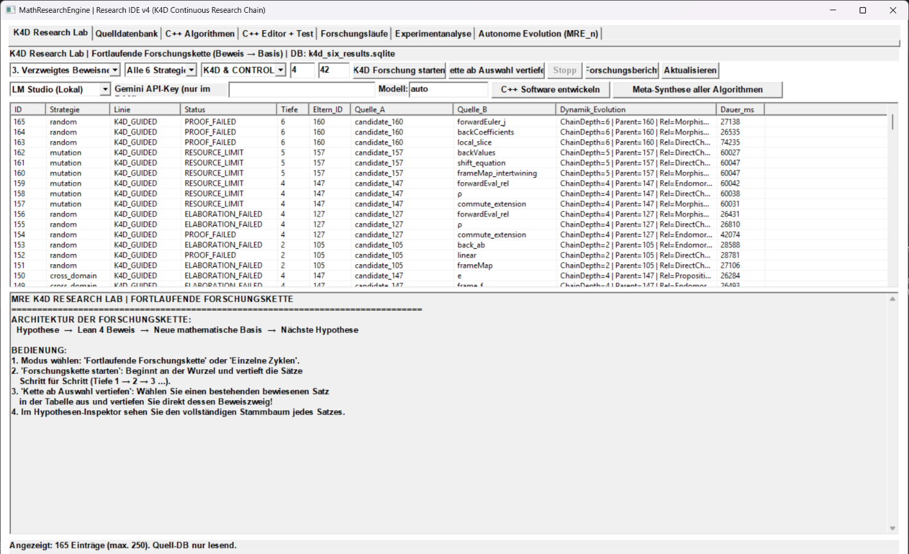
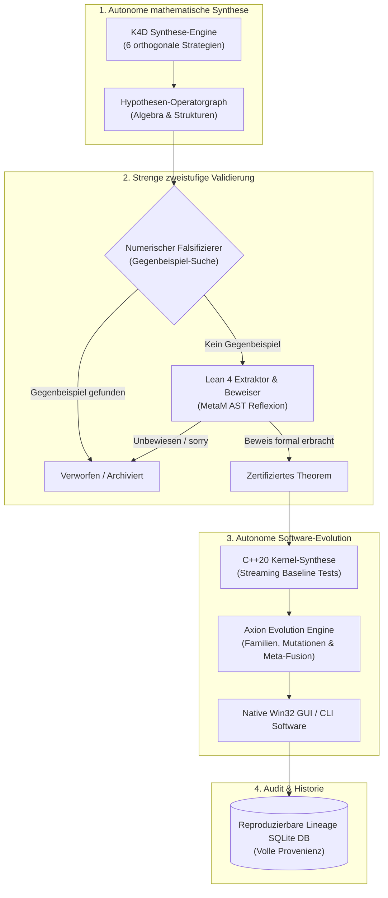
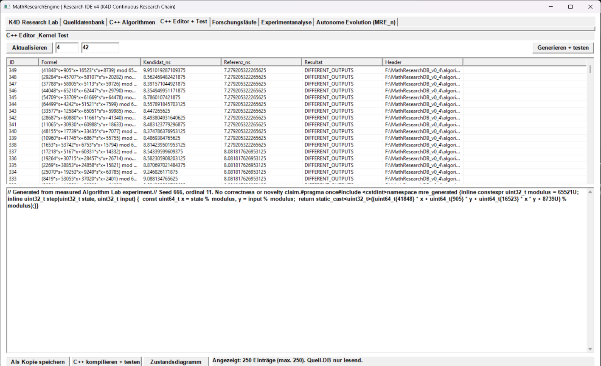

# Axion – Autonomous Mathematical Research & Code Synthesis Engine

<p align="center">
  
</p>

<p align="center">
  
  
  
  
  
  
  
</p>

---

## 🔬 Über das Projekt

**Axion** ist eine High-Performance-Forschungsplattform, die autonome mathematische Erkenntnisfindung mit formaler Beweisverifikation und nativer C++-Code-Synthese vereint.

Im Gegensatz zu rein statistischen Sprachmodellen stützt sich Axion auf eine **strenge mathematische Orakel-Architektur**: Jede generierte Hypothese wird vor ihrer Annahme zweistufig auditiert – zunächst durch hochdynamische **numerische Falsifikations-Routinen** gegen Gegenbeispiele und anschließend durch den interaktiven Theorembeweiser **Lean 4**. Formal verifizierte Theoreme werden danach vollautomatisch in optimierte C++20-Rechenkerne und native Windows-Anwendungen überführt.

* **Entwickler:** Ralf Krümmel  
* **Technologie:** C++20, Win32 Native API, Lean 4 Interactive Theorem Prover, SQLite3, LLVM/Clang & MSVC Toolchains.

---

## 🏛️ Systemarchitektur



---

## 📸 Visuelle Eindrücke der Axion IDE

Die Axion Research IDE (`axion_ide.exe`) bietet ein responsives, modernes Slate-Dark-Interface für alle Forschungs- und Syntheseschritte:

<p align="center">
  <b>K4D Forschungsketten & Verzweigte Beweisnetze</b><br>
  
</p>

<p align="center">
  <b>C++ Kernel-Synthese & Algorithmen-Labor</b><br>
  
</p>

<p align="center">
  <b>Autonome Evolution Engine & Meta-Fusion zweier Algorithmen-Familien</b><br>
  
</p>

<p align="center">
  <b>Phasenraum- & Konvergenzdiagramme (Trace-Plotting)</b><br>
  
</p>

---

## ⚡ Kernfunktionen

### 1. K4D Hypothesen-Forschungsnetzwerke
* **6 Entdeckungs-Strategien:** `type_synthesis`, `systematic`, `random`, `cross_domain`, `mutation`, `iterative`.
* **Verzweigte Beweisbäume:** Autonome Erkundung komplexer algebraischer Beziehungen mit kontrolliertem Forschungsbudget.
* **Isolierte Quellhaltung:** Mathematische Ursprungsdatenbanken bleiben strikt schreibgeschützt (*Read-Only*).

### 2. Formale Lean 4 Beweis-Verifikation
* Direkte Schnittstelle zur offiziellen Lean 4 Toolchain.
* Syntaktische MetaM-Reflexion für Typkonsistenz und Term-Strukturen.
* Vollständiger Ausschluss unbewiesener Axiome (`sorry`-Sperre).

### 3. Autonome Software-Evolution & Meta-Fusion
* Automatische Erzeugung kompilierbarer, nativer Windows-Programme aus mathematischen Kernen.
* **Meta-Fusion**: Kreuzung komplementärer Algorithmen-Familien (z. B. Tensor Attention & RoPE) zu neuen Hybrid-Architekturen.
* Lückenlose Dokumentation von Generationen, Fitness-Werten und Mutationen.

### 4. Moderne Win32 Research IDE
* **Dark Mode & Modernes Design:** Fließende dunkle Farbgebung, Dark-Mode-Titelleiste via DWM API.
* **Eingebautes Info-Menü:** Transparente Einsicht in Entwicklerdaten (Ralf Krümmel) und die mathematische Methodik.
* **Code-Editor:** Live C++ Bearbeitung mit integrierter Fehlerdiagnose.

---

## 📐 Mathematische Algorithmen & Methodik

Alle mathematischen Algorithmen und Pipelines in Axion wurden von **Ralf Krümmel** konzipiert und implementiert:

* **Formale Beweise:** Lean 4 interaktive Theorembeweis-Umgebung (`lean/LeanSynthesizer.lean`).
* **Spektrale Validierung:** Konsistenzprüfung relationaler Hypothesen über Laplace-Matrizen und spektrale Graphentheorie.
* **Orakel-Falsifikation:** Dynamische Gegenbeispiel-Suche im modularen und reellen Raum vor dem Beweisaufwand.
* **Operatorgraphen:** Heuristische Komposition algebraischer Signaturen unter strikter Typ-Erhaltung.

Ausführliche Details finden Sie in [docs/MATHEMATICAL_FOUNDATIONS.md](docs/MATHEMATICAL_FOUNDATIONS.md).

---

## 🛠️ Bauen & Starten

### Voraussetzungen
* **Betriebssystem:** Windows 10 / 11 (64-Bit)
* **Compiler:** KR MultiHost Compiler oder Visual Studio 2022 (C++20, MSVC v143) mit Windows SDK
* **CMake:** Version 3.21 oder neuer
* **Optional:** Lean 4 (`elan`) für formale Beweisprüfungen

### Option A: Bauen mit dem portablen KR-Compiler (Empfohlen)

```powershell
Start-Process -FilePath "H:\KR_COMPILER\KR-Portable-CPP-MultiHost_v2.4\KR-COMPILE.exe" `
    -ArgumentList "--build", "H:\Axion", "--target", "WINDOWS", "--configuration", "Release" -Wait
```

### Option B: Bauen mit CMake / Visual Studio

```powershell
.\BUILD_AXION.ps1
```

Nach erfolgreichem Build befinden sich alle Binaries in:
```text
H:\Axion\KR_BUILD\Release\
├── axion_engine.exe              # Kern-Forschungs-Engine (CLI)
├── axion_ide.exe                 # Grafische Desktop-Forschungsumgebung
├── math_software_lab.exe         # Autonomes Software-Laboratorium
├── math_multi_relation.exe       # Relationale Hypothesengraphen
└── ... (weitere 16 Module)
```

---

## 🚀 Schnellstart

### 1. Axion Research IDE starten
Doppelklick auf `START_AXION_IDE.cmd` oder über PowerShell:
```cmd
START_AXION_IDE.cmd
```

### 2. Vollständige Selbsttest-Suite ausführen
Axion verfügt über eine deterministische 18-Punkte-Validierungssuite, die alle Teilsysteme automatisiert prüft:
```powershell
.\KR_BUILD\Release\axion_engine.exe selftest .\KR_BUILD\selftest
```
Ergebnis:
```text
=====================================================================
    AXION ENGINE VALIDATION SUITE (18-POINT SPECIFICATION)           
    Entwickler: Ralf Krümmel                                         
=====================================================================
[Test 1/18] C++20 Build & Compiler Environment: PASSED
[Test 2/18] Automated Test Framework: PASSED
[Test 3/18] SQLite Integration (WAL, Transactions): PASSED
[Test 4/18] Database Schema Migration: PASSED
[Test 5/18] Experiment Interruption & Resumption: PASSED
[Test 6/18] Semantic Lean Extraction: PASSED
[Test 7/18] Type-Compatible Function Composition: PASSED
[Test 8/18] Type-Incompatible Combination Rejection: PASSED
[Test 9/18] Resolvable Premise (Tactic Discharge): PASSED
[Test 10/18] Unresolvable Premise Tracking: PASSED
[Test 11/18] Numerically Refutable Hypothesis Detection: PASSED
[Test 12/18] Formally Proven Hypothesis Verification (Lean 4): PASSED
[Test 13/18] Unprovable / False / Sorry Hypotheses Rejection: PASSED
[Test 14/18] Missing Lean Import Handling: PASSED
[Test 15/18] Execution Timeout Enforcement: PASSED
[Test 16/18] Deterministic Repeatability with PRNG Seeds: PASSED
[Test 17/18] Cross-Domain Selection & Certificate Filtering: PASSED
[Test 18/18] End-to-End Autonomous Research Cycle: PASSED
=====================================================================
TEST RESULTS: 18 / 18 PASSED
=====================================================================
```

---

## 📁 Projektstruktur

```text
H:\Axion\
├── src/                          # Kern-Implementierung (Engine, Orakel, Synthese, Evolution)
├── ui/                           # Axion Research IDE (Win32 Native, Dark Mode, Info-Dialog)
├── k4d/                          # K4D Forschungsnetzwerk-Modul
├── lean/                         # Lean 4 Reflexions- und Syntheseskripte
├── mre-gui/                      # Schlanke Forschungszentrale (Launcher)
├── discovery/                    # Autonome Anwendungsentdeckung
├── evaluation/                   # Nutzen-Evaluator & Baselines
├── evolution/                    # Evolutionäre Software-Forschung
├── language/                     # MRE_APP_1 typisierte Operator-Sprache
├── memory/                       # Persistenter Forschungsspeicher
├── purpose_lab/                  # Offene Zweck-Hypothesen
├── tests/                        # Integrationstests & Test-Fixtures
├── docs/                         # Technische Dokumentation
│   ├── images/                   # Screenshots für GitHub & Dokumentation
│   ├── ARCHITECTURE.md           # Detaillierte Systemarchitektur
│   ├── MATHEMATICAL_FOUNDATIONS.md # Mathematische Methodik & Herkunft
│   └── IDE_GUIDE.md              # Bedienungsanleitung der IDE
├── CMakeLists.txt                # CMake Build-Konfiguration (Axion)
├── BUILD_AXION.ps1               # PowerShell Build-Skript
└── START_AXION_IDE.cmd           # 1-Klick-Starter für die IDE
```

---

## 👤 Entwickler & Kontakt

* **Konzeption & Entwicklung:** Ralf Krümmel  
* **Repository:** [GitHub](https://github.com/)  
* **Lizenz:** [MIT License](LICENSE)
