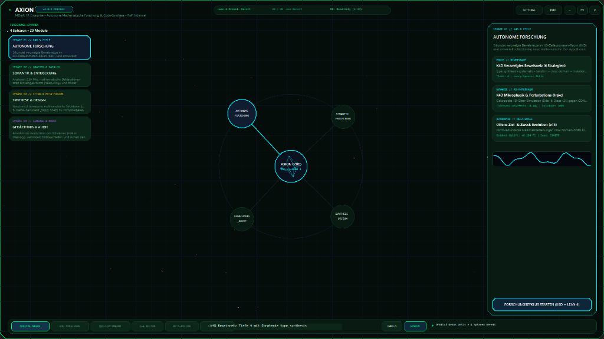
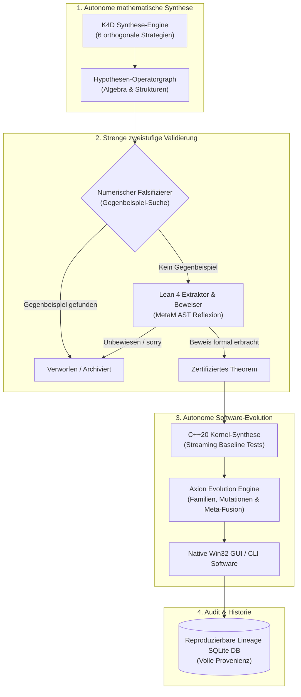
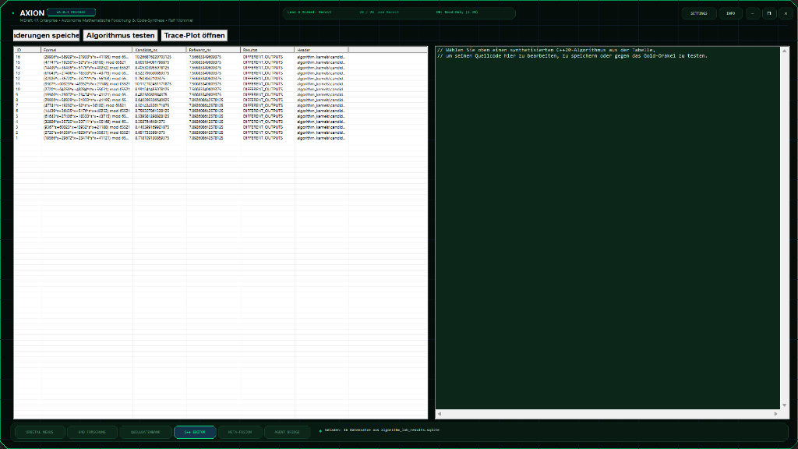
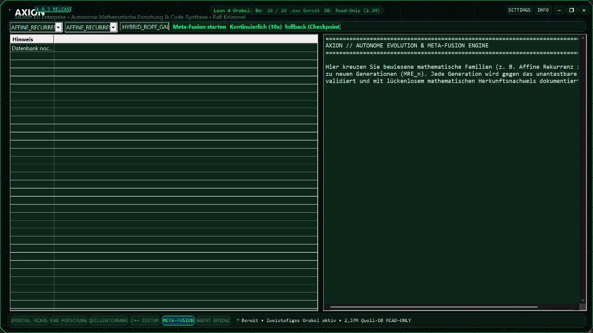
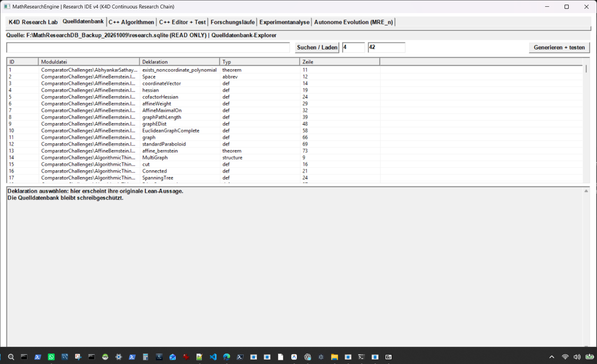
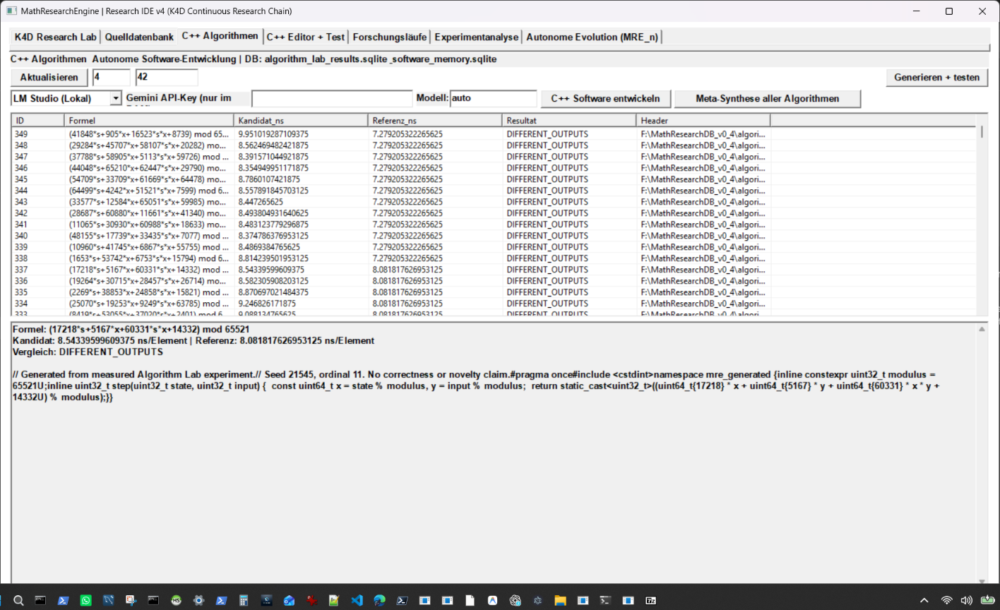
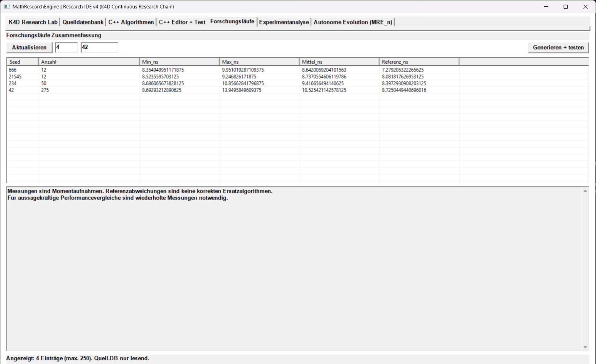

# Axion – Autonomous Mathematical Research & Code Synthesis Engine

<p align="center">
  
</p>

<p align="center">
  
  
  
  
  
  
  
  
</p>

---

## 🔬 Über das Projekt

**Axion** ist eine High-Performance-Forschungsplattform, die autonome mathematische Erkenntnisfindung mit formaler Beweisverifikation und nativer C++-Code-Synthese in einem futuristischen, rahmenlosen **Spatial Orbital HUD** vereint.

Im Gegensatz zu rein statistischen Sprachmodellen stützt sich Axion auf eine **strenge mathematische Orakel-Architektur**: Jede generierte Hypothese wird vor ihrer Annahme zweistufig auditiert – zunächst durch hochdynamische **numerische Falsifikations-Routinen** gegen Gegenbeispiele (in $\mathbb{Z}/65521\mathbb{Z}$ und $\mathbb{R}$) und anschließend durch den interaktiven Theorembeweiser **Lean 4**. Formal verifizierte Theoreme werden danach vollautomatisch in optimierte C++20-Rechenkerne und native Windows-Anwendungen überführt.

* **Entwickler & Konzeption:** Ralf Krümmel (MDraft KR Enterprise)  
* **Technologie:** C++20, Win32 Native GDI/DWM API, Lean 4 Interactive Theorem Prover, SQLite3 v3.53.4 (WAL), LLVM-MinGW & MSVC Toolchains.

---

## 🏛️ Systemarchitektur



---

## 📸 Visuelle Eindrücke der Axion IDE

Die Axion Research IDE (`axion_ide.exe`) bietet ein responsives, flimmerfreies Interface mit abgeschrägten Tech-Kanten (`chamfer-frame`), tiefem Obsidian-Hintergrund und adaptiven Farbschemata:

<p align="center">
  <b>1. Spatial Orbital Nexus – AXION CORE mit 4 Forschungs-Sphären</b><br>
  
</p>

<p align="center">
  <b>2. Orbital Nexus Kernansicht (Zentraler 4D-Hyperraum & Orbit-Projektion)</b><br>
  
</p>

<p align="center">
  <b>3. Autonome Evolution Engine & Meta-Fusion (Dark-Theme ListView & Custom Buttons)</b><br>
  
</p>

<p align="center">
  <b>4. K4D Forschungsketten & Verzweigte Beweisnetze</b><br>
  
</p>

<p align="center">
  <b>5. C++ Kernel-Synthese & Algorithmen-Labor</b><br>
  
</p>

<p align="center">
  <b>6. Phasenraum- & Konvergenzdiagramme (Trace-Plotting)</b><br>
  
</p>

---

## ⚡ Highlights & Kernfunktionen

### 1. Spatial Orbital HUD (Interface der nächsten Generation)
* **Rahmenloses Polygon-Design**: Vollständig polygon-gechamfertes Fenster (`WS_POPUP` mit `CreatePolygonRgn`), frei von Windows-Fensterrahmen.
* **100 % Flimmerfrei**: Echtes GDI-Double-Buffering mit `WS_CLIPCHILDREN | WS_CLIPSIBLINGS` und selektivem 60-FPS-Timer (automatische Pause in Daten- und Code-Workspaces).
* **4 Farbschemata / Design-Templates** (über das Menü **SETTINGS** wählbar):
  1. **Deep Obsidian (Cyber Cyan)**: Klassisches tiefes Weltraum-Schwarz mit leuchtendem Cyan.
  2. **Solar Flare Amber (Neon Gold)**: Warmer Obsidian-Hintergrund mit edlen Bernstein- und Gold-Akzenten.
  3. **Hyperdrive Cobalt (Quantum Blue)**: Tiefblaues High-Tech-Terminal mit eisblauem Kontrast.
  4. **Biolith Emerald (Matrix Core)**: Dunkles Moosgrün mit Neongrün-Hervorhebungen.
* **Reaktive Schriftgrößen-Skalierung**:
  - **Kompakt (10pt)**: Maximale Datendichte für große Tabellen und Monitore.
  - **Standard (13pt)**: Perfekt ausbalanciert für den Forschungsalltag.
  - **Groß (18pt UI / 20pt Editor / 30pt Titel)**: Optimale Lesbarkeit auf 4K-Bildschirmen.

### 2. 4 Autonome Forschungs-Sphären
* **Sphäre 01 // K4D & ZIELE (Autonome Forschung)**:
  Erkundet verzweigte Beweisnetze im 4D-Zellautomaten-Raum mit 6 orthogonalen Entdeckungsstrategien (`type_synthesis`, `systematic`, `random`, `cross_domain`, `mutation`, `iterative`).
* **Sphäre 02 // GRAPHEN & KATALOG (Semantik & Entdeckung)**:
  Analysiert 2,36 Millionen mathematische Deklarationen strikt schreibgeschützt (*Read-Only*) und findet mehrstufige Brückenpfade zwischen Disziplinen.
* **Sphäre 03 // C++20 & META-FUSION (Synthese & Design)**:
  Transformiert zertifizierte Theoreme in optimierten C++20-Quellcode und kreuzt mathematische Familien via Meta-Fusion.
* **Sphäre 04 // LINEAGE & AUDIT (Gedächtnis & Audit)**:
  Lückenlose Speicherung des Fehlergedächtnisses (*Failure Memory*) und mathematischer Herkunftsnachweise.

### 3. Zweistufige Orakel-Validierung (Lean 4 MetaM)
* Direkte Schnittstelle zur offiziellen Lean 4 Toolchain.
* Syntaktische MetaM-Reflexion für Typkonsistenz und Term-Strukturen.
* Vollständiger Ausschluss unbewiesener Axiome (`sorry`-Sperre).

---

## 📐 Mathematische Algorithmen & Methodik

Alle mathematischen Algorithmen und Pipelines in Axion wurden von **Ralf Krümmel** konzipiert und implementiert:

* **Formale Beweise:** Lean 4 interaktive Theorembeweis-Umgebung (`lean/LeanSynthesizer.lean`).
* **Spektrale Validierung:** Konsistenzprüfung relationaler Hypothesen über Laplace-Matrizen und spektrale Graphentheorie.
* **Orakel-Falsifikation:** Dynamische Gegenbeispiel-Suche im modularen und reellen Raum vor dem Beweisaufwand.
* **Operatorgraphen:** Heuristische Komposition algebraischer Signaturen unter strikter Typ-Erhaltung.

Ausführliche mathematische Hintergründe finden Sie in [docs/MATHEMATICAL_FOUNDATIONS.md](docs/MATHEMATICAL_FOUNDATIONS.md).

---

## 📚 Mathematischer Wissenskorpus (2,37 Millionen Formeln & Theoreme)

Axion greift auf einen umfangreichen mathematischen Wissenskorpus (`research.sqlite`) zu, der über 2,36 Millionen mathematische Definitionen, Typen, Prämissen und Formeln umfasst:
* **`declarations`:** **2.369.933** mathematische Aussagen & Theoreme
* **`imports`:** **149.204** relationale Modul-Abhängigkeiten
* **`files`:** **48.266** Quell-Dateien

### 📥 Download der Datenbank
Die vorbereitete Datenbank steht als komprimiertes Release-Asset auf GitHub bereit:
* **Asset-Download:** [Axion-Mathematical-Corpus-2.3M-research-db.zip](https://github.com/kruemmel-python/Axion/releases/download/v1.0.0/Axion-Mathematical-Corpus-2.3M-research-db.zip)

### 🔌 Einbindung in Axion

1. **Entpacken:**  
   Entpacken Sie das Archiv und legen Sie die Datei `research.sqlite` in den Ordner `data/` innerhalb Ihres Axion-Verzeichnisses:
   ```text
   H:\Axion\data\research.sqlite
   ```
   *(Alternativ kann die Datei auch direkt im Stammverzeichnis als `H:\Axion\research.sqlite` abgelegt werden.)*

2. **Nutzung in der Axion Research IDE (`axion_ide.exe`):**
   * Starten Sie die IDE über `START_AXION_IDE.cmd`.
   * Wechseln Sie zum Workspace **„Quelldatenbank“** oder **„K4D Forschung“**.
   * Die IDE erkennt `data/research.sqlite` beim Start automatisch und schaltet die Durchsuchung von 2,3+ Millionen Formalisierungen frei.

3. **Nutzung über die Axion Konsole (`axion_engine.exe`):**
   * **Statistiken des Korpus abrufen:**
     ```cmd
     axion_engine.exe stats data\research.sqlite
     ```
   * **Forschungszyklus mit 6 K4D-Strategien starten:**
     ```cmd
     axion_engine.exe cycle-k4d-six data\research.sqlite results.sqlite research_output 10 42
     ```

---

## 🛠️ Bauen & Starten

### Voraussetzungen
* **Betriebssystem:** Windows 10 / 11 (64-Bit)
* **Compiler:** KR MultiHost Compiler oder Visual Studio 2022 (C++20, MSVC v143) mit Windows SDK
* **CMake:** Version 3.21 oder neuer
* **Optional:** Lean 4 (`elan`) für formale Beweisprüfungen

### Option A: Bauen mit dem portablen KR-Compiler (Empfohlen)

```powershell
Start-Process -FilePath "H:\KR_COMPILER\KR-Portable-CPP-MultiHost_v2.4\KR-COMPILE.exe" `
    -ArgumentList "--build", "H:\Axion", "--target", "WINDOWS", "--configuration", "Release" -Wait
```

### Option B: Bauen mit CMake / Visual Studio

```powershell
.\BUILD_AXION.ps1
```

Nach erfolgreichem Build befinden sich alle Binaries in:
```text
H:\Axion\KR_BUILD\Release\
├── axion_engine.exe              # Kern-Forschungs-Engine (CLI)
├── axion_ide.exe                 # Spatial Orbital HUD (Desktop-IDE)
├── math_software_lab.exe         # Autonomes Software-Laboratorium
├── math_multi_relation.exe       # Relationale Hypothesengraphen
└── ... (weitere 16 Module)
```

---

## 🚀 Schnellstart

### 1. Axion Research IDE starten
Doppelklick auf `START_AXION_IDE.cmd` oder über PowerShell:
```cmd
START_AXION_IDE.cmd
```

### 2. Vollständige Selbsttest-Suite ausführen
Axion verfügt über eine deterministische 18-Punkte-Validierungssuite, die alle Teilsysteme automatisiert prüft:
```powershell
.\KR_BUILD\Release\axion_engine.exe selftest .\KR_BUILD\selftest
```
Ergebnis:
```text
=====================================================================
    AXION ENGINE VALIDATION SUITE (18-POINT SPECIFICATION)           
    Entwickler: Ralf Krümmel                                         
=====================================================================
[Test 1/18] C++20 Build & Compiler Environment: PASSED
[Test 2/18] Automated Test Framework: PASSED
[Test 3/18] SQLite Integration (WAL, Transactions): PASSED
[Test 4/18] Database Schema Migration: PASSED
[Test 5/18] Experiment Interruption & Resumption: PASSED
[Test 6/18] Semantic Lean Extraction: PASSED
[Test 7/18] Type-Compatible Function Composition: PASSED
[Test 8/18] Type-Incompatible Combination Rejection: PASSED
[Test 9/18] Resolvable Premise (Tactic Discharge): PASSED
[Test 10/18] Unresolvable Premise Tracking: PASSED
[Test 11/18] Numerically Refutable Hypothesis Detection: PASSED
[Test 12/18] Formally Proven Hypothesis Verification (Lean 4): PASSED
[Test 13/18] Unprovable / False / Sorry Hypotheses Rejection: PASSED
[Test 14/18] Missing Lean Import Handling: PASSED
[Test 15/18] Execution Timeout Enforcement: PASSED
[Test 16/18] Deterministic Repeatability with PRNG Seeds: PASSED
[Test 17/18] Cross-Domain Selection & Certificate Filtering: PASSED
[Test 18/18] End-to-End Autonomous Research Cycle: PASSED
=====================================================================
TEST RESULTS: 18 / 18 PASSED
=====================================================================
```

---

## 📁 Projektstruktur

```text
H:\Axion\
├── src/                          # Kern-Implementierung (Engine, Orakel, Synthese, Evolution)
├── ui/                           # Spatial Orbital HUD (Win32 Native, Dark Mode, Info- & Settings-Dialog)
├── k4d/                          # K4D Forschungsnetzwerk-Modul (4D-Hyperraum & Attraktoren)
├── lean/                         # Lean 4 Reflexions- und Syntheseskripte
├── mre-gui/                      # Schlanke Forschungszentrale (Launcher)
├── discovery/                    # Autonome Anwendungsentdeckung
├── evaluation/                   # Nutzen-Evaluator & Baselines
├── evolution/                    # Evolutionäre Software-Forschung (Meta-Fusion)
├── language/                     # MRE_APP_1 typisierte Operator-Sprache
├── memory/                       # Persistenter Forschungsspeicher
├── purpose_lab/                  # Offene Zweck-Hypothesen
├── tests/                        # Integrationstests & Test-Fixtures
├── docs/                         # Technische Dokumentation & Screenshots
│   ├── images/                   # UI-Screenshots für GitHub & Dokumentation
│   ├── ARCHITECTURE.md           # Detaillierte Systemarchitektur
│   ├── MATHEMATICAL_FOUNDATIONS.md # Mathematische Methodik & Herkunft
│   └── IDE_GUIDE.md              # Bedienungsanleitung der IDE
├── CMakeLists.txt                # CMake Build-Konfiguration (Axion)
├── BUILD_AXION.ps1               # PowerShell Build-Skript
└── START_AXION_IDE.cmd           # 1-Klick-Starter für die IDE
```

---

## 👤 Entwickler & Kontakt

* **Konzeption & Entwicklung:** Ralf Krümmel (MDraft KR Enterprise)  
* **Repository:** [https://github.com/kruemmel-python/Axion](https://github.com/kruemmel-python/Axion)  
* **Lizenz:** [MIT License](LICENSE)
