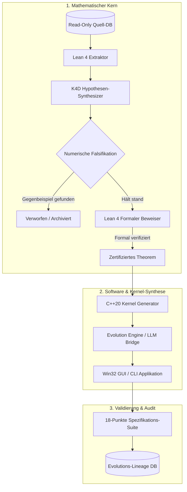

# Axion – Systemarchitektur & Technische Dokumentation

**Entwickler:** Ralf Krümmel  
**Plattform:** Windows x64 | C++20 | Lean 4 | SQLite3 | KR MultiHost Toolchain

---

## 1. Systemüberblick

Axion ist eine integrierte mathematische Forschungs- und Software-Evolutionsplattform. Sie transformiert mathematische Hypothesen durch formale Verifikation in einsatzfähige, native Softwareprodukte.

---

## 2. Kernkomponenten

### 2.1 Axion Engine (`axion_engine.exe`)
Die zustandslose, hochoptimierte C++20-Forschungskonsole:
* **Hypothesen-Synthese:** Ausführung der 6 Synthesestrategien (`cycle-k4d-six`).
* **Verifikations-Pipeline:** Falsifikation gegen numerische Punktscharen und Lean-Beweis-Validierung.
* **Selbsttest-Suite:** Deterministischer 18-Punkte-Funktionstest aller Module.

### 2.2 Axion Research IDE (`axion_ide.exe`)
Die native Win32-Desktop-Arbeitsumgebung im modernen Slate-Dark-Design:
* **K4D Research Lab:** Interaktives Triggern linearer oder baumartig verzweigter Forschungsketten.
* **C++ Algorithmen-Editor:** Live-Inspektion, Bearbeitung und Kompilierung erzeugter C++ Operator-Kernel.
* **Zustands- & Phasenraumdiagramme:** Grafische Visualisierung von Evaluierungsmetriken.
* **Autonome Evolution & Meta-Fusion:** Kreuzung zweier erfolgreicher mathematischer Familien zu einer neuen hybriden Architektur.
* **Menü Info:** Direkte Einsicht in Entwicklerangaben (Ralf Krümmel) und mathematische Algorithmenherkunft.

### 2.3 Lean 4 Integrationsbrücke (`lean/`)
* **`LeanExtractor.lean`:** Extraktion von Deklarationen, Typ-Signaturen und Gleichungseigenschaften.
* **`LeanSynthesizer.lean`:** Generierung vollständiger Beweisdateien mit formalen Zielen.

### 2.4 Evolution & Software-Synthese (`evolution/`, `src/evolution_engine.cpp`)
* Generiert aus verifizierten Theoremen vollständige Windows-Softwareprojekte (CMakeLists.txt, Quellcode, Benutzeroberfläche).
* Führt automatische Härtetests durch und protokolliert alle Generationen reproduzierbar in SQLite.

---

## 3. Datenhaltung & Isolation

* **Quelldatenbanken bleiben unberührt (Read-Only):** Axion modifiziert niemals die historischen mathematischen Ursprungsdatenbanken.
* **Eigene Forschungsdatenbanken:** Alle Hypothesen, Beweise und Audit-Logs werden in separaten SQLite-Dateien mit aktivierter Write-Ahead-Logging (WAL) Architektur gespeichert.
