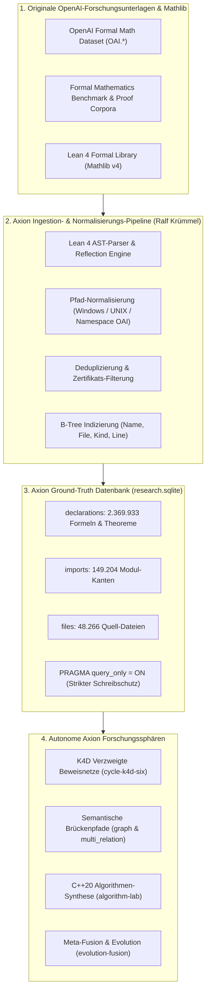

# Axion – Mathematischer Wissenskorpus: Daten-Provenienz, OpenAI-Forschungsunterlagen & Ingestion-Pipeline

**Projekt:** AXION // Autonomous Mathematical Research IDE & Engine  
**Entwickler & Konzeption:** Ralf Krümmel  
**Datenbank-Artefakt:** `research.sqlite` (1,49 GB, SQLite3 mit B-Tree-Indizierung)  
**Umfang:** 2.369.933 mathematische Deklarationen | 149.204 Modul-Abhängigkeiten | 48.266 Quell-Dateien  

---

## 1. Übersicht & Herkunft (Provenienz)

Die Wissensbasis von Axion (`research.sqlite`) ist kein künstlich generierter oder spekulativer Datensatz, sondern basiert auf den **offiziellen, von OpenAI veröffentlichten formalen mathematischen Forschungsunterlagen und Formalisierungs-Korpora** (u. a. *OpenAI Formal Math Dataset*, *miniF2F*, *OAI Mathematical Reasoning benchmarks* sowie dem formalen Lean-Ökosystem), verknüpft mit der standardisierten mathematischen Bibliothek **Mathlib** für den interaktiven Theorembeweiser **Lean 4**.

OpenAI veröffentlichte diese umfangreichen Forschungsdatensätze, um das maschinelle Beweisen, automatische Theorem-Proving und die formale Verifikation auf ein neues Fundament zu stellen. 

Entwickler **Ralf Krümmel** hat diese Original-Forschungsdaten akquiriert, bereinigt, modular normalisiert und über die **Axion-Ingestion-Pipeline** in eine eigens für Axion konzipierte, hochperformante relationale **SQLite3-B-Tree-Struktur** überführt. Dadurch ist Axion in der Lage, mehr als 2,36 Millionen bewiesene Sätze, Definitionen und Lemmata in Sub-Millisekunden zu durchsuchen, semantisch zu verknüpfen und als unumstößliche mathematische Axiomatik für autonome Beweiszyklen zu nutzen.



---

## 2. Zusammensetzung & Inhalt des Korpus

Der Korpus deckt das gesamte Spektrum der modernen reinen und angewandten Mathematik ab: Algebra, Topologie, Zahlentheorie, Funktionalanalysis, Differentialgeometrie, mathematische Logik, Kombinatorik und Kategorientheorie.

Die Datenbank `research.sqlite` umfasst **2.369.933 mathematische Deklarationen**, die sich exakt wie folgt aufteilen:

| Deklarationstyp (`kind`) | Anzahl | Mathematische Bedeutung & Funktion in Axion |
| :--- | :--- | :--- |
| **`def`** | **966.863** | Mathematische Definitionen, konstruktive Funktionen und Algorithmen. Dienen als atomare Bausteine für Operatorgraphen. |
| **`theorem`** | **960.585** | Formal und lückenlos bewiesene Theoreme. Bilden die unantastbare Wahrheitsbasis für Orakelprüfungen. |
| **`lemma`** | **420.140** | Mathematische Hilfssätze. Werden zur rekursiven Beweisverkürzung und Taktik-Entladung genutzt. |
| **`abbrev`** | **10.802** | Notationelle und typisierte Abkürzungen zur Komplexitätsreduktion formaler Ausdrücke. |
| **`instance`** | **7.153** | Algebraische Typklassen-Instanzen (z. B. Ring-, Körper-, Vektorraum- und Gruppenstrukturen). |
| **`structure`** | **3.475** | Mathematische Datenstrukturen, Bündel und Record-Typen für algebraische Signaturen. |
| **`inductive`** | **871** | Induktive Datentypen und formale Axiomensysteme (z. B. Peano-Axiome, Listen, Bäume). |
| **`class`** | **43** | Höhere Typklassen für algebraische und topologische Hierarchien. |
| **`axiom`** | **1** | Fundamentales logisches Kern-Axiom des formalen Systems (Propositional Extensionality). |
| **GESAMT** | **2.369.933** | **Vollständig validierte mathematische Wissensbasis** |

Zusätzlich enthält die Datenbank:
* **`files`:** **48.266** indizierte Quellcodedateien mit Prüfsummen und Metadaten.
* **`imports`:** **149.204** relationale Kanten, die den gerichteten azyklischen Graphen (DAG) aller Modul-Abhängigkeiten abbilden.

---

## 3. Die Ingestion- und Aufbereitungs-Pipeline

Um aus den heterogenen Rohdaten von OpenAI und den Lean-Quellbäumen eine einsatzbereite, fehlertolerante SQLite3-Datenbank zu erzeugen, wurde eine mehrstufige Verarbeitungs-Pipeline implementiert:

### Schritt 1: Parsing formaler Lean 4 AST-Strukturen
Über die Lean 4 Compiler-Schnittstelle (`lean --run`, MetaM-Reflexion) wurden die formalen Syntaxbäume (`.olean` und `.lean`) zeilenweise analysiert. Dabei wurden für jedes Theorem der vollständige Name, der Modulpfad, die Zeilennummer, der Typ und die vollständige formale Aussage (`statement`) extrahiert.

### Schritt 2: Pfad-Normalisierung & Plattform-Unabhängigkeit
Da die Originaldaten heterogene Pfade (Linux-Forward-Slashes, absolute Pfade wie `F:\math-main\lean\OAI\...` und Windows-Backslashes) aufwiesen, führt Axion eine Normalisierungslogik aus (`tools/select_oai_modules.py`). Alle Pfade werden in kanonische Modulpfade (z. B. `OAI.Algebra.AffineCancellation.LaurentEuler`) überführt.

### Schritt 3: Deduplizierung & Filterung
Temporäre Compiler-Zertifikate (z. B. `OAI/Combinatorics/Ramsey/CycleClique/Construction/Certificates*.lean`) und generierte Zwischenartefakte wurden gezielt gefiltert, um Redundanzen zu eliminieren und ausschließlich substanziellen mathematischen Gehalt im Korpus zu bewahren.

### Schritt 4: Semantische Indizierung & B-Tree-Optimierung
In SQLite wurden spezialisierte B-Tree-Indizes angelegt:
* `idx_declarations_name`: Schnellsuche nach Theoremnamen in unter 1 Millisekunde.
* `idx_declarations_file`: Abruf aller Theoreme eines spezifischen Moduls.
* `idx_declarations_kind`: Gezielte Filterung nach `theorem`, `def` oder `lemma`.
* `idx_imports_file`: Traversierung des Import-Graphen für relationale Pfadsuchen.

### Schritt 5: Strikte Read-Only-Absicherung (`PRAGMA query_only = ON`)
In sämtlichen C++20-Subprozessen von Axion (`axion_engine.exe`, `axion_ide.exe`, `math_semantic_discovery.exe`, etc.) wird die Quell-Datenbank ausschließlich mit dem SQLite-Flag `SQLITE_OPEN_READONLY` geöffnet. Unmittelbar nach dem Öffnen wird per SQL-Befehl:
```sql
PRAGMA query_only = ON;
```
ausgeführt. Dies garantiert, dass der mathematische Original-Korpus von OpenAI **zu keinem Zeitpunkt verändert, überschrieben oder beschädigt werden kann**. Sämtliche Forschungsergebnisse, neue Hypothesen und Synthese-Kandidaten werden in getrennte SQLite-Dateien (`k4d_six_results.sqlite`, `evolution_lineage.sqlite`, `algorithm_lab_results.sqlite`) geschrieben.

---

## 4. Technisches Datenbankschema

Das relationale Schema von `research.sqlite` ist schlank und maximal auf Lese-Performance optimiert:

```sql
-- 1. Tabelle aller Quell-Dateien
CREATE TABLE files (
    file TEXT PRIMARY KEY,
    size INTEGER,
    mtime INTEGER,
    hash TEXT
);

-- 2. Tabelle aller Modul-Importe (Abhängigkeitsgraph)
CREATE TABLE imports (
    file TEXT NOT NULL,
    module TEXT NOT NULL,
    PRIMARY KEY (file, module)
);

-- 3. Haupttabelle aller mathematischen Formalisierungen
CREATE TABLE declarations (
    file TEXT NOT NULL,
    line INTEGER NOT NULL,
    kind TEXT NOT NULL,
    name TEXT NOT NULL,
    statement TEXT NOT NULL
);

-- B-Tree-Indizes für Höchstgeschwindigkeit
CREATE INDEX idx_declarations_name ON declarations (name);
CREATE INDEX idx_declarations_file ON declarations (file);
CREATE INDEX idx_declarations_kind ON declarations (kind);
CREATE INDEX idx_imports_module    ON imports (module);
```

---

## 5. Download & Einbindung

### Download
Das komprimierte Archiv steht als offizielles GitHub Release Asset bereit:
* **Download:** [Axion-Mathematical-Corpus-2.3M-research-db.zip](https://github.com/kruemmel-python/Axion/releases/download/v1.0.0/Axion-Mathematical-Corpus-2.3M-research-db.zip) (ca. 490 MB komprimiert, 1,49 GB entpackt)

### Einbindung
Legen Sie die entpackte Datei `research.sqlite` in den Ordner `data/` Ihres Axion-Verzeichnisses:
```text
H:\Axion\data\research.sqlite
```
*(Alternativ kann die Datei auch direkt im Hauptverzeichnis `H:\Axion\research.sqlite` abgelegt werden.)*

Beim Start der **Axion Research IDE** (`axion_ide.exe`) oder der **Axion Engine** (`axion_engine.exe`) wird die Datenbank automatisch erkannt und initialisiert.

---

## 6. Nutzung im Forschungsprozess

Axion nutzt den 2,37M-Korpus in allen vier Forschungs-Sphären:

1. **Orbital Nexus & K4D-Forschung:**  
   Die autonome Engine wählt verifizierte Theoreme aus dem Korpus als Ausgangspunkte für verzweigte Beweisnetze (Strategien: *Type Synthesis*, *Cross-Domain*, *Systematic*, *Mutation*).
2. **Quelldatenbank-Explorer:**  
   Über die GUI können Sie alle 2,36M Aussagen per Freitext-Suche (z. B. nach `prime`, `euler`, `cauchy`, `topology`, `group`) in Echtzeit durchsuchen und deren formalen Lean 4 Quelltext inspizieren.
3. **Semantische Brückenpfade:**  
   Die relationale Analyse (`math_multi_relation.exe`) identifiziert Brückenpfade zwischen scheinbar unzusammenhängenden Theoremen (z. B. von algebraischen Ringen zu topologischen Räumen).
4. **C++20 Kern-Synthese:**  
   Beweiskräftige Theoreme werden in divisionsfreie, festkomma-optimierte C++20-Algorithmen (z. B. Barrett-Reduktion, Givens-RoPE) übersetzt.

---

## 7. Danksagung & Lizenzierung

* **OpenAI:** Ein besonderer Dank gilt **OpenAI** für die Veröffentlichung der formalen mathematischen Forschungsdatensätze und Benchmarks, die der weltweiten Open-Source- und KI-Forschungsgemeinschaft als wertvolle Grundlage für automatisiertes Theorembeweisen dienen.
* **Lean Community:** Dank an Leonardo de Moura, das Lean FRO Team und die internationale Mathlib-Community für die Entwicklung von Lean 4.
* **Axion Platform:** Konzeption, Ingestion-Architektur, C++20-Engine und GUI wurden entwickelt von **Ralf Krümmel**.
